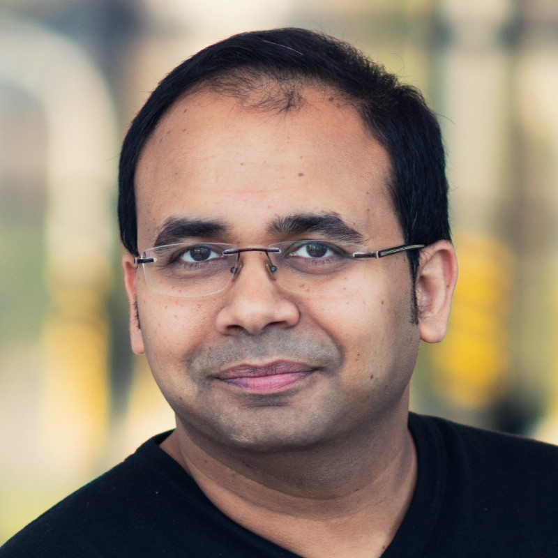

# Sustainable Microarchitecture
*From Silicon to Datacenter — Co-Designing AI Systems Across the Stack*

[Program](#program) | [Topics](#topics) | [Format](#format) | [Organisers](#organisers)

AI workloads are fundamentally reshaping computing's energy profile, yet sustainability is still treated as a secondary optimization rather than a first-order design constraint. Worse, current trends show the embodied footprint of computing — from raw-material extraction and semiconductor manufacturing through assembly and end-of-life — is approaching or exceeding the operational footprint, a shift that most architecture and systems research has yet to internalize. Sustainability has been established as a cross-cutting architectural concern over the recent years, and a central thesis in achieving sustainable compute system architecture is Architecture-Technology Co-Optimization (ATCO), where architectural decisions, packaging choices, and manufacturing processes must be jointly evaluated against sustainability objectives rather than optimized in isolation.

This workshop brings together four complementary perspectives to address this gap across the full computing stack and the full product lifecycle. At the silicon and package level, we examine how advanced packaging and 3D integration can reduce both operational energy and manufacturing waste. At the datacenter level, we address cloud-scale efficiency through inference serving disaggregation, power stabilization for AI training clusters, and hardware memory compression. Bridging these layers, we present cross-stack co-design methodologies for environmentally sustainable computing — from specialized hardware for recommendation and agentic AI workloads with open-source benchmarking through MLPerf, that decomposes computing's environmental impact into actionable architectural levers. The holistic lifecycle perspective — spanning extraction, manufacturing, use, and end-of-life — provides the conceptual spine that connects every technical contribution. We also extend this trajectory by integrating [IMEC's SSTS initiative](https://www.imec-int.com/en/expertise/cmos-advanced/sustainable-semiconductor-technologies-and-systems-ssts), closing the loop between architecture-level design exploration and quantitative manufacturing footprint assessment.

## Program

| Time  | Session | Speaker | Topic | Resources |
|---|---|---|---|---|
| 08:00 - 08:15 | Introduction | Timon Evenblij | Overview of the Workshop |   |
| 08:15 - 09:30 | Session 1 | To be announced |   |   |
| 09:30 - 10:00 | Session 2 | To be announced |   |   |
| 10:00 - 10:30 | Coffee Break |   |   |   |
| 10:30 - 11:00 | Session 2 | To be announced |   |   |
| 11:00 - 12:00 | Session 3 | Panel Discussion |   |   |

## Topics

* Holistic lifecycle sustainability: embodied vs. operational footprint, and full-lifecycle LCA
* Quantifying the manufacturing footprint: imec.netzero virtual fab modeling and the SSTS industry consortium
* Energy-efficient silicon: advanced packaging (chiplets, DRAM-on-Logic, 3D integration) and SoC/SiP design for sustainability
* Cloud-scale AI efficiency: Splitwise inference disaggregation, power stabilization, hardware memory compression
* Cross-stack co-design: specialized systems for recommendation and agentic AI, democratizing AI on resource-constrained hardware
* Manufacturing sustainability R&D (PFAS-free materials, process gas abatement)

## Format

### Session 1 — Industry Perspectives
*Sustainable AI from Fab to Cloud: What Industry Is Building and Deploying*
 
This session is meant to equip attendees with a concrete understanding of what industry is actively building and deploying to address computing sustainability — from semiconductor manufacturing through cloud-scale AI infrastructure. Attendees will see how lifecycle assessment tooling (imec.netzero) quantifies the environmental cost of chip fabrication, how advanced packaging and 3D integration reduce operational energy at the silicon level, and how production-deployed systems for inference disaggregation, power stabilization, and memory compression are achieving measurable efficiency gains in hyperscale AI datacenters today.
 
### Session 2 — Academic Perspectives
*Frameworks, Metrics, and Methodologies for Sustainable Architecture Research*

The objective of this session is to provide attendees with the conceptual frameworks and research methodologies needed to embed sustainability into architecture and systems research. Attendees will learn how to treat environmental sustainability as a first-order design constraint across the full computing stack, how open-source benchmarking and workload characterization enable reproducible sustainability research, and how holistic lifecycle thinking — from raw-material extraction to end-of-life — reframes architectural optimization when the embodied footprint rivals or exceeds the operational footprint.
  
### Session 3 — Panel Discussion 
*Where Do We Go from Here? Bridging Industry Practice and Academic Research for Sustainable Computing*
 
In this session, we synthesize the industry and academic perspectives into actionable next steps for the community. A moderated panel of our invited speakers from the industry and academia, with audience participation, will address three provocations:

1. What sustainability metrics should architecture conferences require in paper evaluations?
2. How do we close the gap between manufacturing-level LCA data and system-level design decisions?
3. Is the embodied-vs-operational crossover a temporary trend or a permanent shift — and what does that mean for research priorities?

**Co-Design Exercise**: This session concludes beyond the panel discussion with a *hands-on co-design exercise* where cross-disciplinary groups develop sustainable architecture strategies for a representative AI workload.

## Organisers

| | |
|---|---|
|  | **Timon Evenblij (imec)** is a Principal Member of Technical Staff at the Compute System Architecture (CSA) department at imec. He received the M.S. degree in computer science engineering from Ghent University. He joined imec in 2017. His research is focused on performance modeling and performance analysis for future computer systems. As future systems utilize intensive hardware–software codesign, he is interested in all performance and power optimizations crossing multiple layers of the computer architecture stack, spanning from applications to semiconductor technology innovations. |
|  | **Udit Gupta (Cornell Tech)** is an Assistant Professor in the Department of Electrical and Computer Engineering at Cornell Tech. His research interests lie at the intersection of computer architecture, systems, machine learning and environmental sustainability by co-designing solutions across the computing stack (applications, algorithms, systems and architecture, circuits and devices). Udit’s work has been recognized as IEEE MICRO Top Picks in 2023 and 2022 as well as received the SIGARCH Outstanding Ph.D. Dissertation Honorable Mention and the SIGMICRO Outstanding Ph.D. Dissertation Honorable Mention. |
|  | **Arindam Mallik (imec)** leads Compute System Architecture (CSA) department at imec. He is a technologist enabling HW-SW co-design at the cross-point of AI algorithms, computer architecture, and novel technology solutions. Arindam has spent the past 20 years pushing the boundaries of technology research to provide novel solutions with a direct impact on the semiconductor industry. He has authored or co-authored more than 100 papers in international journals, conference proceedings, and holds number of relevant patents. He received M.S. and PhD degree in Electrical Engineering and Computer Science from Northwestern University, USA in 2004 and 2008, respectively.|